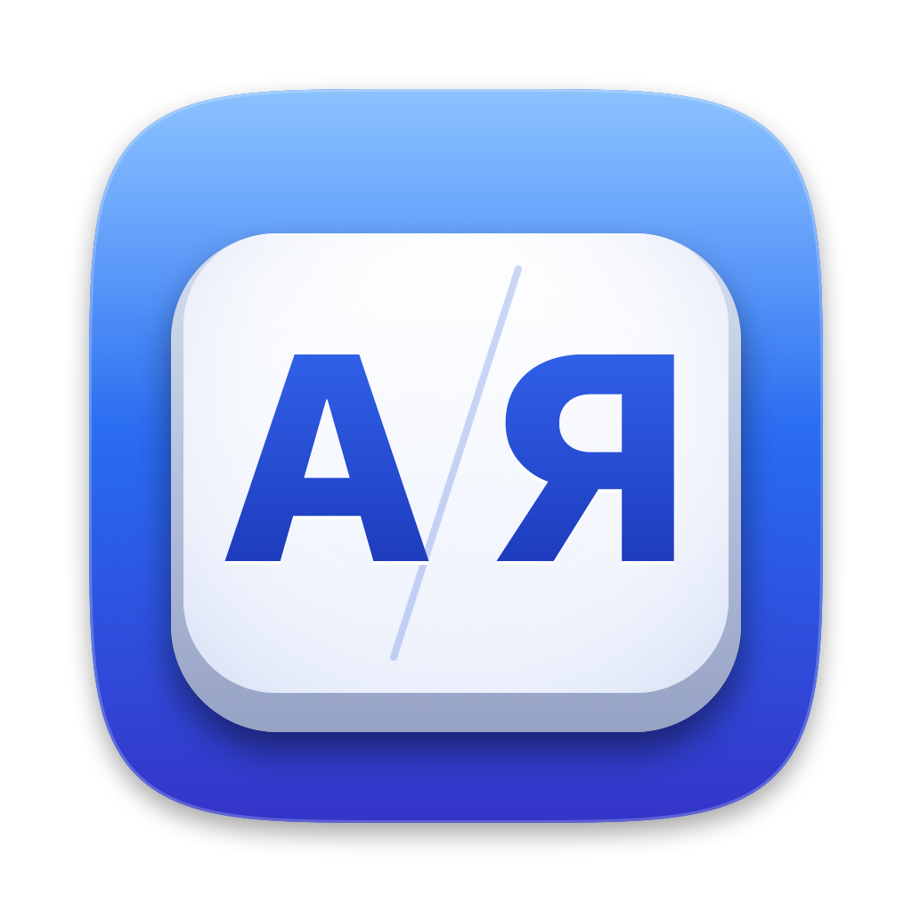

<div align="center">

[English](README.md) | [Русский](README.ru.md)



# LangSwitcher

**Switch the keyboard layout with a Cmd+Shift tap. Tiny, native, lives in your menu bar.**


[](https://github.com/mrJolla/lang-switcher/releases/latest)

[Website](https://mrjolla.github.io/lang-switcher/) ·
[Download](https://github.com/mrJolla/lang-switcher/releases/latest/download/LangSwitcher.dmg) ·
[Releases](https://github.com/mrJolla/lang-switcher/releases)

</div>

LangSwitcher is a small native menu-bar app for macOS that does one thing: it switches the input source when you tap **Cmd+Shift**, like Punto Switcher does. No Xcode project, no dependencies, universal binary (arm64 + x86_64).

> The menu is in Russian for now; localization is not done yet. The [website](https://mrjolla.github.io/lang-switcher/) is available in 7 languages.

## Features

- **Cmd+Shift tap** switches the layout. Press and release both keys (either order, left or right keys). Nothing else may happen in between: other keys, mouse clicks, Ctrl or Option cancel the gesture. So Cmd+Shift+Z, Cmd+Shift+4 or Cmd+Shift+click do not switch. Caps Lock is ignored.
- **Cycles through your enabled keyboard layouts** in system order. Only sources that can actually be selected take part.
- **Choose which layouts participate** from the menu; the choice is remembered.
- **Current layout label** (EN, RU, ...) in the menu bar.
- **Launch at login** (via SMAppService).
- Native Swift, no third-party code, universal (Apple Silicon and Intel), macOS 13 or newer.

## Installation

1. **Download** [LangSwitcher.dmg](https://github.com/mrJolla/lang-switcher/releases/latest/download/LangSwitcher.dmg).
2. **Drag** LangSwitcher.app to the Applications folder.
3. **Open Anyway.** The app is not notarized, so Gatekeeper blocks the first launch. Try to open it once, close the warning, then go to System Settings > Privacy & Security, scroll down and click **Open Anyway** next to LangSwitcher. On macOS 15 and later right-click > Open no longer works. Terminal alternative:
   ```sh
   xattr -dr com.apple.quarantine /Applications/LangSwitcher.app
   ```
4. **Input Monitoring.** Open the menu bar item > "Выдать разрешение…" (Grant permission), or System Settings > Privacy & Security > Input Monitoring, and enable LangSwitcher. No restart needed: the app checks every 2 seconds.
5. **Done.** Tap Cmd+Shift.

## Usage

Tap **Cmd+Shift** anywhere. The menu bar item shows the current layout; click it for the menu (labels are in Russian):

| Menu item | Meaning |
| --- | --- |
| Включено | Enable or disable switching |
| Запускать при входе в систему | Launch at login |
| Раскладки | Submenu: choose which layouts take part in the cycle |
| Разрешение выдано / Выдать разрешение… | Input Monitoring status and a shortcut to the settings |
| Выход | Quit |

To list detected input sources: `/Applications/LangSwitcher.app/Contents/MacOS/LangSwitcher --list-sources`.

## FAQ and troubleshooting

**Switching stopped working after an update or rebuild.**
The app is ad-hoc signed, so every new build looks like a different app to macOS and the Input Monitoring permission is dropped. Reset it and grant it again:
```sh
tccutil reset ListenEvent io.github.mrjolla.langswitcher
```
Then relaunch the app (or remove the old LangSwitcher entry in Input Monitoring with "-" and add it again).

**Why is it not notarized?**
Notarization requires a paid Apple Developer ID. The app is open source and you can build it yourself (see below); until then use Open Anyway.

**A Korean/CJK input mode is skipped or shown as unavailable.**
macOS does not allow some input modes (for example Korean, error -50) to be selected programmatically. LangSwitcher detects these and leaves them out of the cycle. For CJK sources that do work, macOS sometimes ignores the first selection, so the app verifies the result and retries after 0.08 s and 0.25 s.

**How do I uninstall?**
Move LangSwitcher.app to the Trash, remove it from Input Monitoring and Login Items, and optionally run `defaults delete io.github.mrjolla.langswitcher`.

## Build from source

Only the Command Line Tools are needed (no Xcode). The version lives in `Info.plist`.

```sh
make build      # arm64 dev build -> build/LangSwitcher.app
make release    # universal (arm64 + x86_64), ad-hoc signed
make dmg        # release + dist/LangSwitcher-<version>.dmg and dist/LangSwitcher.dmg
make test       # self-test of the gesture state machine
make install    # copy to ~/Applications and launch
make uninstall
make clean
```

## Website

The landing page in `docs/` is served by GitHub Pages (branch `main`, folder `/docs`). It is generated from `site/translations.py` and `site/build.py` for 7 languages. After editing, run:

```sh
python3 site/build.py
```

and commit the result. The Download button points to `releases/latest/download/LangSwitcher.dmg`, so attach `dist/LangSwitcher.dmg` to every release.

## Privacy

LangSwitcher listens to keyboard modifier and key/mouse-click events locally through a listen-only event tap, only to detect the Cmd+Shift gesture. It does not record or store what you type, and it has no network code at all.

## Credits

Made by [mrJolla](https://github.com/mrJolla). Inspired by Punto Switcher.
