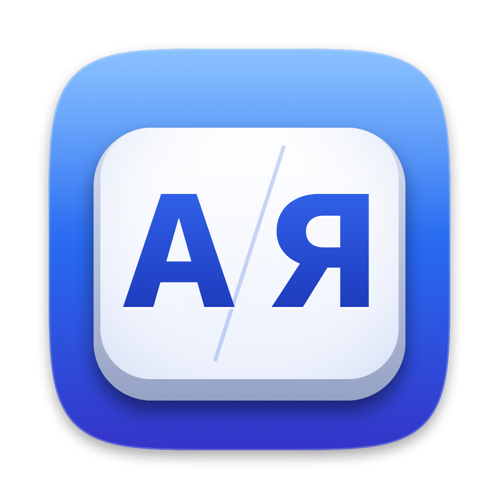

<div align="center">

[English](README.md) | [Русский](README.ru.md)



# LangSwitcher

**Переключение раскладки по нажатию Cmd+Shift. Маленькое нативное приложение в строке меню.**


[](https://github.com/mrJolla/lang-switcher/releases/latest)
[](LICENSE)

[Сайт](https://mrjolla.github.io/lang-switcher/) ·
[Скачать](https://github.com/mrJolla/lang-switcher/releases/latest/download/LangSwitcher.dmg) ·
[Релизы](https://github.com/mrJolla/lang-switcher/releases)

</div>

LangSwitcher — нативное приложение для строки меню macOS, которое делает одно: переключает раскладку по **Cmd+Shift**, как Punto Switcher. Без проекта Xcode и зависимостей, universal-сборка (arm64 + x86_64).

> Меню приложения следует языку системы (7 языков: английский, русский, немецкий, испанский, итальянский, французский, бразильский португальский). [Сайт](https://mrjolla.github.io/lang-switcher/) доступен на тех же 7 языках.

## Возможности

- **Нажатие Cmd+Shift** переключает раскладку: нажмите и отпустите обе клавиши (в любом порядке, левые или правые). Между этим не должно быть других клавиш, кликов мыши, Ctrl или Option. Cmd+Shift+Z, Cmd+Shift+4, Cmd+Shift+клик не переключают. Caps Lock игнорируется.
- **Цикл по включённым раскладкам** в системном порядке; участвуют только источники, которые реально выбираются.
- **Выбор раскладок** для цикла в меню; выбор сохраняется.
- **Метка текущей раскладки** (EN, RU, ...) в строке меню.
- **Запуск при входе в систему** (SMAppService).
- Swift без сторонних библиотек, universal (Apple Silicon и Intel), macOS 13 и новее.

## Установка

1. **Скачайте** [LangSwitcher.dmg](https://github.com/mrJolla/lang-switcher/releases/latest/download/LangSwitcher.dmg).
2. **Перетащите** LangSwitcher.app в папку «Программы».
3. **«Всё равно открыть».** Приложение не нотаризовано, поэтому Gatekeeper блокирует первый запуск. Попробуйте открыть его, закройте предупреждение, затем в Системные настройки → Конфиденциальность и безопасность прокрутите вниз и нажмите **«Всё равно открыть»** рядом с LangSwitcher. В macOS 15 и новее «правый клик → Открыть» не работает. Альтернатива через Терминал:
   ```sh
   xattr -dr com.apple.quarantine /Applications/LangSwitcher.app
   ```
4. **Мониторинг ввода.** Меню → «Выдать разрешение…» или Системные настройки → Конфиденциальность и безопасность → Мониторинг ввода, включите LangSwitcher. Перезапуск не нужен: приложение проверяет разрешение раз в 2 секунды.
5. **Готово.** Нажмите Cmd+Shift.

## Использование

Нажимайте **Cmd+Shift** где угодно. В строке меню видна текущая раскладка; по клику открывается меню:

| Пункт | Назначение |
| --- | --- |
| Включено | Включить/выключить переключение |
| Запускать при входе в систему | Автозапуск |
| Раскладки | Подменю: какие раскладки участвуют в цикле |
| Разрешение выдано / Выдать разрешение… | Статус «Мониторинга ввода» и быстрый переход в настройки |
| Выход | Завершить приложение |

Список найденных источников ввода: `/Applications/LangSwitcher.app/Contents/MacOS/LangSwitcher --list-sources`.

## FAQ и решение проблем

**После обновления или пересборки переключение перестало работать.**
Приложение подписано ad-hoc, поэтому каждая новая сборка выглядит для macOS другим приложением, и разрешение «Мониторинг ввода» сбрасывается. Сбросьте его и выдайте заново:
```sh
tccutil reset ListenEvent io.github.mrjolla.langswitcher
```
Затем перезапустите приложение (или удалите старую запись LangSwitcher в «Мониторинге ввода» кнопкой «−» и добавьте заново).

**Почему нет нотаризации?**
Для неё нужен платный Apple Developer ID. Код открыт, приложение можно собрать самому (см. ниже); пока используйте «Всё равно открыть».

**Корейский/CJK режим пропускается или помечен «недоступна».**
macOS не позволяет программно выбрать некоторые режимы ввода (например Korean, ошибка -50). LangSwitcher их определяет и исключает из цикла. Для CJK-источников, которые работают, macOS иногда игнорирует первый выбор, поэтому приложение проверяет результат и повторяет выбор через 0.08 и 0.25 с.

**Как удалить?**
Перетащите LangSwitcher.app в Корзину, удалите запись из «Мониторинга ввода» и «Объектов входа», при желании выполните `defaults delete io.github.mrjolla.langswitcher`.

## Сборка из исходников

Нужны только Command Line Tools (Xcode не нужен). Версия задаётся в `Info.plist`.

```sh
make build      # arm64, быстрая dev-сборка -> build/LangSwitcher.app
make release    # universal (arm64 + x86_64), ad-hoc подпись
make dmg        # release + dist/LangSwitcher-<версия>.dmg и dist/LangSwitcher.dmg
make test       # самотест автомата жестов
make install    # копирование в ~/Applications и запуск
make uninstall
make clean
```

## Сайт

Лендинг из `docs/` отдаёт GitHub Pages (ветка `main`, папка `/docs`). Он генерируется на 7 языках из `site/translations.py` и `site/build.py`. После правок выполните:

```sh
python3 site/build.py
```

и закоммитьте результат. Кнопка «Скачать» ведёт на `releases/latest/download/LangSwitcher.dmg`, поэтому к каждому релизу прикладывайте `dist/LangSwitcher.dmg`.

OG-картинки: `python3 site/og.py` рендерит их и сжимает без потерь (oxipng, zopflipng, optipng или запасной вариант через ImageMagick; идентичность пикселей проверяется). `python3 site/og.py --optimize-only docs/assets/*.png` только пересжимает готовые PNG без перерендера.

## Конфиденциальность

LangSwitcher локально получает события модификаторов, клавиш и кликов мыши через event tap только для чтения, исключительно чтобы распознать жест Cmd+Shift. Введённый текст не записывается и не сохраняется, сетевого кода в приложении нет.

## Лицензия

MIT. См. [LICENSE](LICENSE). Программу можно использовать, копировать, изменять, объединять, публиковать, распространять, сублицензировать и продавать его копии при сохранении уведомления об авторских правах.

## Автор

[mrJolla](https://github.com/mrJolla). Идея — Punto Switcher.
